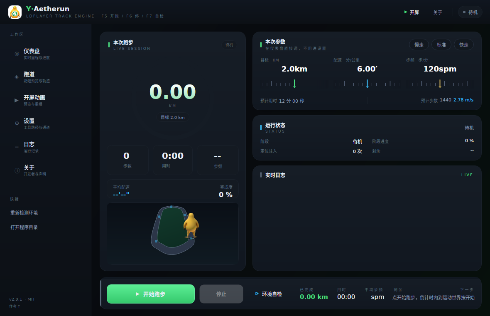
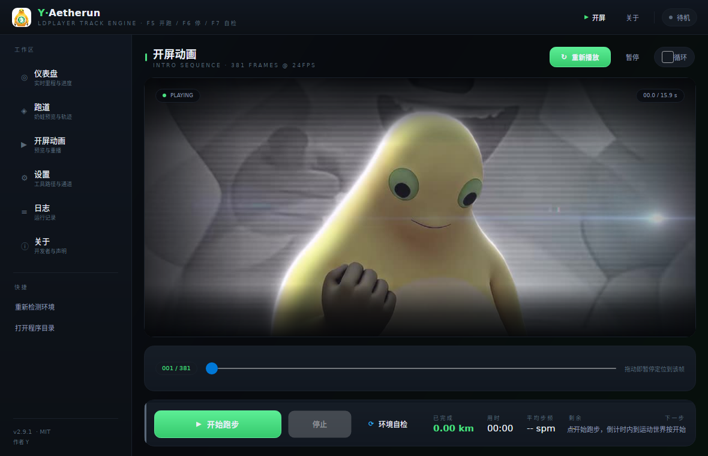

# Y·Aetherun(DGUT专用)

**雷电模拟器 · 校园跑轨迹与步频引擎**

一个 Windows 桌面工具，用雷电模拟器的管理接口同时驱动两件事：把手机 GPS 坐标按操场跑道逐点推进，把加速度传感器按设定步频摆动。界面上的仪表盘实时显示里程、步数、用时与配速。此乃DGUT人的心血，第一代莞工奶蛙的不断变好离不开往后诸君的不断努力，技术开源，代码开源，只为越来越好！

可能有些bug，那个步频有点bug，用时最好使用标准的模式

> 书斋试剑，模拟器内绘莞工轨迹；守心有度，仅供研习，不劝越界。

---

## 它做什么

| 通道 | 实际调用 | 为什么这样做 |
| --- | --- | --- |
| 定位 | `ldconsole locate --index N --LLI 经度,纬度` | 直接写进 GPS HAL，不经过 Android 的 test provider，所以 App 读到的 Location 不带 `isMock` 标记 |
| 步频 | `ldconsole action --index N --key call.gravity --value 0,0,z` | 第三个分量就是 z 轴加速度数值本身，可以在 4.0 ~ 16.0 之间摆动造出波峰波谷 |

两条通道都是雷电自带的 CLI，安装包体积小、不需要 root、不需要 Xposed、不需要 frida。

## 环境要求

- Windows 10 / 11 x64
- 雷电模拟器 9 或更高版本（推荐 Android 14 实例，`ro.build.version.sdk >= 34`）
- 模拟器内已开启 ROOT（右上角齿轮 → 其他设置 → ROOT 权限）
- 目标 App 的 `minSdkVersion = 26`，所以 Android 7 以下的实例装不上

工具启动时会自己扫 `C/D/E/F:\{leidian,LDPlayer,Program Files\LDPlayer,...}\{LDPlayer14,LDPlayer12,LDPlayer9}\ldconsole.exe`，扫不到就在「设置」页手填。

自己编译、跑自检、重新烘奶蛙网格的步骤见 [docs/BUILD.md](docs/BUILD.md)。

## 快速开始

1. 打开雷电，启用 ROOT，启动一个 Android 14 实例。
2. 解压运行 `Y·Aetherun.exe`，开屏动画播完（或点「跳过」）进入主界面。
3. 到「设置」页点「重新检测环境」，确认 `ldconsole.exe` 与 `adb.exe` 都找到了、实例号列出来了。
4. 回到「仪表盘」，用三个滑轮调参数：
   - **目标** 0.5 ~ 2.0 km
   - **配速** 2′00″ ~ 10′00″ 每公里
   - **步频** 60 ~ 300 步每分钟
   也可以直接点「慢走 / 标准 / 快走」，三档分别是 8′00″ / 6′00″ / 4′00″ 每公里（步频 90 / 120 / 150）。
5. 点「开始跑步」。脚本进入 15 秒倒计时，这段时间内到模拟器里按下 App 的「开始」按钮。
6. 里程跑满后自动停止，去 App 里提交成绩。

**校园跑只在 06:00–22:00 计入成绩**，窗口外点开始会被拦下并提示距离开窗还有多久。

## 跑道点位

内置的是 12 个实测点位，闭合周长 388.2 米（标准 400 米跑道内圈），写在 `%APPDATA%\Y-Aetherun\track.txt`，一行一个 `纬度,经度`：

```
22.908578,113.869650
22.909064,113.869674
...
```

想换成自己学校的操场，改这个文件后重启即可。点位是**注入用的坐标**，不需要和高德地图上的真实经纬度一致 —— 只要和模拟器里 App 显示的相对位置对得上即可。3D 预览会把第一个点当作起点。

## 界面

- **仪表盘**：环形进度 + 实时里程 / 步数 / 用时 / 步频 / 配速，右下角是操场 3D 透视图，跑动时会沿跑道推进并留下拖影。
- **跑道**：大尺寸 3D 透视（奶蛙沿跑道奔跑）+ 右侧「奶蛙预览」，可拖动旋转、点「转一圈」看各面。
- **开屏动画**：播放启动动画，可以暂停、逐帧拖动、循环。
- **设置**：工具路径、注入通道参数、设备与倒计时。
- **日志**：最近 500 行运行记录。
- **关于**：项目声明、开发者签名、用法与技术栈。

顶栏的「▶ 开屏动画」随时可以重播启动动画。

### 截图

| 仪表盘 | 跑步中 |
| --- | --- |
|  |  |

| 跑道（奶蛙建模） | 设置 |
| --- | --- |
|  |  |

| 倒计时横幅 | 开屏动画 |
| --- | --- |
|  |  |

| 关于（声明与技术栈） |
| --- |
|  |

奶蛙四个朝向的裸光栅（不含背景与阴影，可以逐像素看有没有空隙）：


## 配置保存在哪

改过的每一个参数都会立刻写进 `%APPDATA%\Y-Aetherun\config.json`，跑道点位存在同目录的 `track.txt`。下次启动原样恢复，不用重填。删掉这个文件夹就回到出厂默认。

- 设置页的 `ldconsole.exe` / `adb.exe` 路径手填即生效，启动时以你填的为准，留空才自动探测 `C/D/E/F` 盘。
- 序列号、目标包名、三个注入开关同样会保存；留空会自动补回默认值，不会出现 `adb -s ""` 这种废命令。

## 更新记录

### 2.9.1

- **奶蛙不再是半透明的了**。2.9.0 的渲染是「按颜色把三角面合并成几批 `StreamGeometry`，再由远到近铺」——同一批里混着远近不同的三角形，后画的那批会把本该被挡住的部分盖到前面，看上去就是能看穿。现在改成**逐像素 z-buffer 的 CPU 软光栅**：每个三角形逐像素算重心坐标、比深度，近的赢，远的直接不画。四个朝向的实测空洞率 0.00%。
- **亚像素缝隙也补掉了**：三角形交界处会漏 1~2 像素的空点，放大后就是「透光」。加了一道封孔（8 邻域里 ≥5 个不透明邻居就按平均色补齐，迭代 3 轮，轮廓边缘因邻居不足不会被误填）。
- **网格密度大幅提高**（用户明确说过「别怕文件体积过大」）：`naiwa_hi.bin` 4640 顶点 / 9428 三角 → **50855 顶点 / 103790 三角**（2.4 MB），新增 `naiwa_mid.bin`（15918 / 32483，772 KB），`naiwa_lo.bin` 1574 / 3174 → 3551 / 7200。按绘制高度自动选档：≥300 px 用高模、≥90 px 用中模、再小才用低模。
- **超采样从 2× 提到 2.5×**，抗锯齿边缘更干净；拖视角时临时降到 1.25× + 中模（每 3° 才重算一张，约 8 ms 一张跟得上手），松手立刻换回高模 + 2.5×。
- 光栅缓存上限 64 MB → 192 MB，转向时不会反复重烘。
- 自检项 277 → 287：新增「确实用了 z-buffer」「三档网格密度下限」「四个朝向各渲染一次并逐像素数空洞、空洞率 ≤0.5%」。
- 顺带修掉自检工具自身的一个坑：`tools/Verify` 现在会初始化 Avalonia（否则加载不了资源），但 `SetupWithoutStarting` 会装上 UI 的 `SynchronizationContext`，导致后面 Engine 段的 `async/await` 永远排不上 → 整个自检卡死。初始化后立刻 `SynchronizationContext.SetSynchronizationContext(null)` 解决。


## 参数范围为什么这么定

| 参数 | 范围 | 依据 |
| --- | --- | --- |
| 目标公里 | 0.5 ~ 2.0 | 校园跑单次有效距离上限 2 km，下限防止误点 |
| 配速 | 2′ ~ 10′ 每公里 | 服务端判定的合理人类配速区间，超出会被判异常 |
| 步频 | 60 ~ 300 步/分 | 服务端提示「步频控制要在 60~300 步每分钟之间」 |
| 有效时间 | 06:00 ~ 22:00 | App 内「当前跑区不在有效时间内」的判定窗口 |

雷电的加速度注入在 5 Hz 采样下，一步至少要覆盖 2 个采样点才识别得出来，所以设定值不要超过 150 —— 再往上峰值检测会把它当噪声丢掉。
不过「我们发多少」和「它认多少」是两件事：运动世界自己还有一层采样与滤波，实测下来慢走 90 只认 67、标准 120 只认 90、快走 150 只认 55。所以现在按它自报的步数做闭环校正（`CadenceGovernor`），发得比目标快、把它认的数字顶到目标值为止。

实际能跑到多少步频，取决于 `ldconsole` 单次调用的往返耗时：一步要两次调用（重力翻高、翻低），
并联 n 个调用时吞吐 ≈ n / 单次延迟。引擎会实时测这个延迟、自动把并发拉到够用的档位（2~6），
顶到上限时仪表盘的步频块上会出现 `LIMIT` 角标，悬停能看到「上限 xxx spm · 单次注入 xx ms」。
这时要么关掉模拟器里的高负载程序、要么把步频压到上限以下，靠堆设定值不会更快。

## 边界

- 步频靠硬件级加速度注入实现，模拟器被降频或后台被限制时会出现漏采，表现为步数少于预期。
- 定位每秒重发一次。雷电的 `locate` 钉子只保持约 12 秒，不重发会被弹回默认点。
- 只支持雷电。MuMu 的 `tool gyro` 只能设姿态角、加速度模长恒为 9.81，造不出 z 轴的波峰，所以没有做适配。

## 项目声明

此仓不过少年闲来磨剑，于模拟器一方小天地，绘莞工操场，写一段轨迹。

一纸代码，如同木剑符箓，只作研习观想，非是教人投机取巧，亦不曾与校方、平台有半点勾连。世间自有章法，如同登山有阶、渡河有渡，有些边界，不可轻越。

书里道理万千，行路却在自家心上。若取此代码把玩，当知何为敬畏，何为分寸。若是借此逾矩，便是自己在心头记上一笔账，是非祸福，皆由执剑人自行担承。

作者只写下这卷闲稿，不担保无错漏，亦不为旁人的抉择背责。可取之处，欢迎同好切磋论道；若是不合世道，便束之高阁，一笑置之。

## 开发者的话

> 天道崩塌，此洞天是莞工操场；
>
> 六十公里天道磨难，我奶蛙一人担之！
>
> 人心当有一杆秤，知可为，知不可为。愿诸君试剑而不堕本心，守好自家那盏灯火。
>
> —— Y

## 免责声明

有言在先：这只是书斋里的一次试笔，代码难免有疏漏瑕疵。编译、运行、二次改动之后生出的一切事端，账号风险、数据问题或是别的风波，都该由持剑行路之人自行承担。莫要将行路的代价，尽数推给写稿之人。

希望大家多多提出修改建议，此为莞工第一代，让后世DGUT免受此痛苦为吾等所求，不可忘记前辈开源精神！不可以一己私欲售卖而产生经济纠纷！

学技当存正道之心，可以琢磨手艺，不可借这手艺去踏破世间既有规矩。

## 技术栈

- 界面：Avalonia 12 · .NET 8 · CommunityToolkit.Mvvm
- 定位：`ldconsole locate --LLI`（GPS HAL，无 mock 标记）
- 步频：`ldconsole action call.gravity`（z 轴加速度）
- 3D 操场：纯 2D 绘制指令的透视投影，无 GPU 依赖
- 奶蛙：glb 离线导出 `NWM1` 网格（最高 50855 顶点 / 103790 三角），运行时逐像素 z-buffer 软光栅 + 平面光照，实心不透，无 GPU 依赖

## 许可

[MIT](LICENSE) © Y
